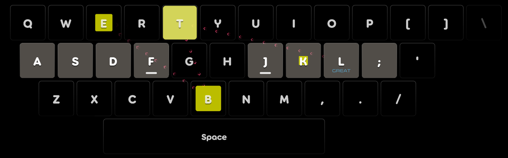
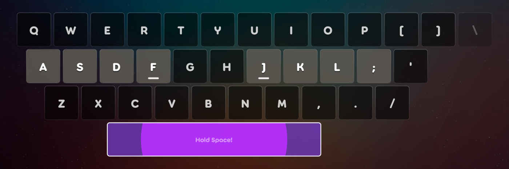
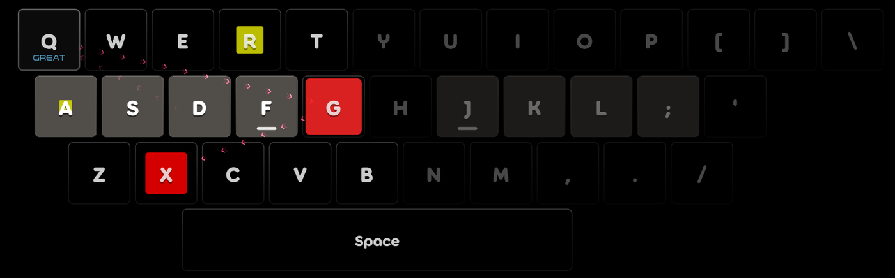

# keybosu!

**Your whole keyboard is the playfield.** keybosu! is a game mode (ruleset) for [osu!lazer](https://github.com/ppy/osu):
coloured squares grow inside the keys of an on-screen keyboard, and you press each key the moment its square is full.
Every osu! beatmap you already have works: it is converted automatically.



**[Download the latest release](../../releases/latest)** · [Install](#install) · [Türkçe](#türkçe)

## How to play

- A square grows inside a key. **Press that key when the square fills it.** The square brightens as the moment comes
  and is brightest exactly on time; if it starts to fade, you are late.
- **Follow points** lead from each note to the next, like in osu!. They use your skin.
- **Spinners** become a hold on the Space bar: keep Space down until the spinner ends.
- Notes land near where they were in the original map: the top of the screen is the top letter row, the left is the left.
- Timing and scoring are the same as osu!: Great, Ok, Meh and Miss, shown under the key you pressed with your skin's
  own graphics. Note colours are your skin's (or the map's) combo colours.
- The game reads keys by where they are, not by what they type, so any keyboard language works. Pick what is printed
  on your keys in the settings.



## Mods

The mods you know from osu!, in the same groups, plus a few of keybosu!'s own.

| Group | Mods |
|---|---|
| Difficulty reduction | Easy, No Fail, Half Time, Daycore |
| Difficulty increase | Hard Rock, Sudden Death, Perfect, Double Time, Nightcore, Hidden, **Original Density** |
| Conversion | Difficulty Adjust, Mirror, **Left Hand**, **Right Hand**, **Home Row** |
| Automation | Autoplay, Cinema |
| Fun | Wind Up, Wind Down, Muted |

keybosu!'s own mods:

- **Original Density** – maps are made easier by default (very fast notes are thinned out, and the keys at the far
  edges are used less). This mod gives you every note of the map, on every key, at the map's own speed.
- **Left Hand / Right Hand** – every note lands on one half of the keyboard, for playing with one hand.
- **Home Row** – every note lands on the eight keys your fingers rest on (A S D F and J K L ; on a QWERTY keyboard).
- **Mirror** – the map flipped left to right.
- **Hidden** – notes fade out before they are due, so you press them from memory.

Keys that a mod leaves without notes are drawn dim:



## Install

1. Download `osu.Game.Rulesets.Keybosu.dll` from the [latest release](../../releases/latest).
2. Put it in the `rulesets` folder inside your osu!lazer data folder (create the folder if it is not there):
   - Windows: `%AppData%\osu\rulesets\`
   - Linux: `~/.local/share/osu/rulesets/`
   - macOS: `~/Library/Application Support/osu/rulesets/`
3. Restart osu!lazer. **keybosu!** is now in the list of game modes.

Updating? Close osu!lazer, replace the file, start the game again. Your scores and settings stay.
If you still have a very old `osu.Game.Rulesets.Keyboard.dll` in that folder, delete it.

## Settings

Under *Settings → Ruleset → keybosu!*. They apply the next time a map starts.

| Setting | What it does |
|---|---|
| **Keyboard layout** | What is printed on the keys: 29 layouts, from English QWERTY to Turkish F, AZERTY, Dvorak and more. |
| **Keyboard type** | ANSI (flat Enter) or ISO (tall Enter, with an extra key left of Z). |
| **Screen centre** | Which part of the keyboard sits in the middle of the screen: the whole keyboard, the Space bar, or the point between your index fingers. |
| **Highlight home row keys** | Gives the eight keys your fingers rest on a lighter colour. |
| **Show judgements** | Great / Ok / Meh / Miss under the key you pressed. |
| **Show follow points** | The points that lead from each note to the next. |

Everything is translated into the 39 languages osu! supports and follows osu!'s own language setting.

## Good to know

- Custom rulesets never give PP.
- Please keep the default key bindings. If your keyboard does not match, choose it under *Keyboard layout* instead.
- A few keys that only some keyboards have are drawn dim and never get notes.
- Star ratings are the map's osu! stars; only the speed mods change them.
- Replays are not recorded yet (Autoplay works).
- If osu!lazer says the ruleset was disabled after a crash, install the latest release again.
- Built for osu!lazer 2026.1026. After a big osu!lazer update the ruleset may need a new release.

Found a bug or have an idea? [Open an issue](../../issues).

## Translations

The translations were first made with AI help, so some may read oddly. If you speak one of the languages, you can fix
them on [Crowdin](https://crowdin.com/project/keybosu): no coding and no GitHub account needed.

## For developers

<details>
<summary>How maps are converted, building and tests</summary>

**Conversion**

- Each object goes to the key nearest to its place on the osu! playfield. A key never shows two notes at once.
- By default, notes closer than half a beat (at least 180 ms) are thinned out, and the first key and last two keys of
  each row get about a quarter of their notes. Original Density turns both off.
- Sliders become a press at the start and one at the end (short ones only the start); reverse sliders also get a
  press on each turn. Spinners, taiko swells and catch banana showers become a hold on Space. osu!mania holds become
  one press.
- Hit windows are osu!standard's (±49.5 / 99.5 / 149.5 ms at OD 5). Quick approach rates are doubled, up to 1400 ms,
  because finding a key takes longer than moving a cursor.
- Follow points are a port of osu!lazer's: a point every 32 units, the same timing and animation, the skin's
  `followpoint` images, Argon's chevrons or the default dots. None between keys that touch, across a new combo or
  around spinners.

**Build and test** (needs the .NET SDK)

```sh
./install.sh                                                  # build and install into osu!lazer (Linux)
dotnet test Keyboard/osu.Game.Rulesets.Keyboard.Tests -c Release
```

The tests run without a window. They press keys through the real input pipeline, play maps with every mod and on
every keyboard type, and check conversion, timing, follow points, translations and settings.

**Never renumber `KeyboardAction`** and never change `ShortName` (`keyboard`): osu!lazer stores key bindings, settings
and scores under them. The English texts are in `Keyboard/osu.Game.Rulesets.Keyboard/Resources/Localisation/en.ini`;
the other files there come from Crowdin, so please do not edit them in a pull request.

</details>

## Licence

[MIT](LICENCE). The project layout and a few unchanged files come from the
[osu! ruleset templates](https://github.com/ppy/osu-templates) by ppy Pty Ltd, also MIT (see [NOTICE](NOTICE)).
keybosu! is a fan-made ruleset and is not affiliated with ppy.

---

## Türkçe

**keybosu!**, bütün klavyenin oyun alanı olduğu bir osu!lazer oyun modu. Ekrandaki klavyenin tuşlarında renkli kareler
büyür; kare tuşu doldurduğu anda o tuşa basarsın. Elindeki bütün osu! haritaları otomatik olarak dönüştürülür.

- **Nasıl oynanır:** Kare dolarken parlar ve tam zamanında en parlak hâline gelir; solmaya başladıysa geç kaldın.
  Follow point'ler bir notadan sonrakine yol gösterir. Spinner'larda Boşluk tuşuna basılı tutarsın.
- **Modlar:** osu!'daki modlar aynı gruplarda (Easy, Hard Rock, Double Time, Nightcore, Hidden, Sudden Death...).
  keybosu!'ya özel olanlar: **Original Density** (haritanın bütün notaları), **Left Hand / Right Hand** (tek elle),
  **Home Row** (sadece parmakların durduğu sekiz tuş) ve **Mirror**.
- **Kurulum:** [Son sürümden](../../releases/latest) `osu.Game.Rulesets.Keybosu.dll` dosyasını indir, osu!lazer veri
  klasöründeki `rulesets` klasörüne koy (Windows: `%AppData%\osu\rulesets\`, Linux: `~/.local/share/osu/rulesets/`),
  oyunu yeniden başlat.
- **Ayarlar:** Klavye düzeni (Türkçe Q ve F dahil 29 düzen), klavye türü, ekran merkezi, temel sıra vurgusu, isabet
  dereceleri ve follow point'ler. Hepsi osu!'nun desteklediği 39 dile çevrili.
- Özel rulesetler PP vermez. Çevirilerde hata görürsen [Crowdin](https://crowdin.com/project/keybosu) üzerinden
  düzeltebilirsin.
