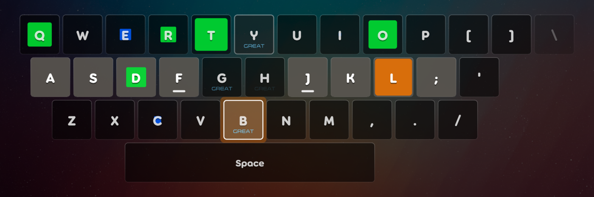
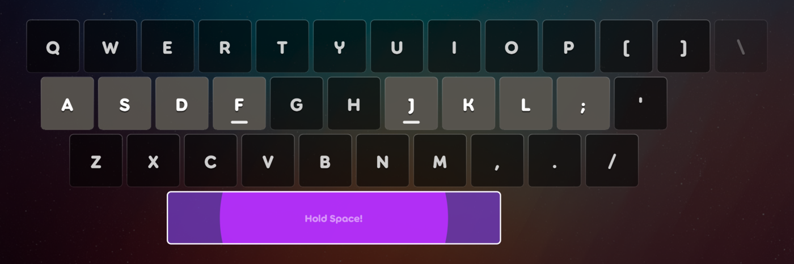

# keybosu!

A custom ruleset for [osu!lazer](https://github.com/ppy/osu) where the whole keyboard is the playfield.



**[Download the latest release](../../releases/latest)** · [How to install](#install) · [Türkçe](#türkçe)

Every letter key - plus the punctuation keys next to the letters - is a square on screen. A coloured square grows
inside a key; **press that key the moment it fills the key**. Spinners become a hold on the Space bar.
Any existing osu! beatmap can be played: it is converted automatically.

## How it plays

- **Notes:** each note of the original map goes to the key nearest to where it was on the osu! playfield
  (top of the screen → top letter row, bottom → bottom row). A key never shows two notes at once: the next one
  only appears when the previous one is over.
- **Sliders** become a press where they start and a press where they end. Short ones (under about one and a half
  beats) are only the first press. Reverse sliders also get a press on every turn, unless the turns come that quickly.
- **Spinners** (and taiko swells / catch banana showers) become a hold on the Space bar. Hold Space for the whole
  spinner: a circle grows out from the middle as you hold. 90%+ is Great, 60%+ Ok, 30%+ Meh, otherwise Miss.
- **Timing** is exactly osu!standard's (300 / 100 / 50): ±49.5 / 99.5 / 149.5 ms at OD 5, the same OD curves and
  rounding, and pressing up to 400 ms early is a Miss.
- **Approach:** squares fill as fast as the map's approach rate (AR) says, like osu!.
- **Colours** are the combo colours, like osu!: from the map when osu!'s "Beatmap colours" setting is on, otherwise
  from your skin's `skin.ini` (`Combo1`, `Combo2`, ...), moving to the next colour at every new combo.
- **Judgements** (Great / Ok / Meh / Miss) appear small under the letter of the key you hit, using your skin's own
  graphics (legacy skins: `hit300` / `hit100` / `hit50` / `hit0`).
- After a **pause**, the same 3-2-1 countdown as osu!mania plays before the map continues.
- Mods: Autoplay, NoFail, HalfTime, DoubleTime. Input is read by physical key position, so your OS keyboard
  language does not matter.



## Settings

Under *Settings → Ruleset → keybosu!*, in osu!'s current settings style:

| Setting | What it does |
|---|---|
| **Keyboard layout** | What is printed on the keys. One layout for every language osu! supports, without duplicates (29, named in their own language, most used first). English QWERTY also covers Indonesian, Filipino, Malay, Dutch, Polish, Lithuanian, Latvian, Vietnamese and Chinese; Spanish covers Catalan. Plus Turkish F, Dvorak and Colemak. |
| **Keyboard type** | ANSI (flat Enter) or ISO (tall Enter, extra key left of Z). |
| **Screen centre** | Which point sits exactly in the middle of the screen: the whole keyboard, the Space bar, or the point between the index fingers (halfway between F and J). |
| **Highlight home row keys** | Gives the eight keys your fingers rest on a lighter colour. The bumps on the index-finger keys are always shown. |
| **Show judgements** | Turns the Great / Ok / Meh / Miss text under the keys on or off. |

A button at the bottom opens this page, for feedback and bug reports. Settings apply the next time a map starts. All texts are translated into the 39 languages osu! supports and follow
osu!'s own language setting (`Keyboard/osu.Game.Rulesets.Keyboard/Resources/Localisation/translations.ini`).

## Install

1. Download `osu.Game.Rulesets.Keyboard.dll` from the [latest release](../../releases/latest).
2. Put it in the `rulesets` folder of your osu!lazer data folder (create the folder if it is missing):
   - Linux: `~/.local/share/osu/rulesets/`
   - Windows: `%AppData%\osu\rulesets\`
   - macOS: `~/Library/Application Support/osu/rulesets/`
3. Restart osu!lazer. **keybosu!** appears in the ruleset selector.

From source (needs the .NET SDK): `./install.sh` builds the ruleset and copies it to the Linux folder above
(set `OSU_DATA` for another data folder).

**Compatibility:** built for ruleset API `2026.818.0` and checked against osu!lazer 2026.1005 on Linux. If an osu!lazer
update changes the ruleset API, the ruleset has to be rebuilt.

## Good to know

- Custom rulesets never award PP.
- osu!'s key overlay shows nothing in this ruleset: the keyboard on screen already shows every key.
- Please keep the default key bindings unless you have to change them. If your keyboard doesn't match, pick it under *Keyboard layout* instead.
- The extra keys (ANSI backslash, ISO key left of Z) are drawn dimmed, never get notes and don't react when pressed. The ISO key at the end of
  the home row cannot be read by osu!framework at all, so it is only drawn.
- While osu!lazer offers "skip intro" it takes Space for itself, so a spinner right at the very start of a map only
  counts once the skip button is gone. Pausing during a break or the intro resumes without a countdown (as in osu!mania).
- Not done yet: replay recording (Autoplay works) and a real star-rating model (currently note density only).

## Development

```sh
dotnet test Keyboard/osu.Game.Rulesets.Keyboard.Tests -c Release
```

The tests run headless. They press every key through the real input pipeline, load real plays on every keyboard
type, play spinners and autoplay, pause and resume, measure the layout on screen, and check conversion, judgements,
translations and settings.

**Never renumber `KeyboardAction`** and never change `ShortName` (`keyboard`): osu!lazer stores key bindings by
those numbers, and settings, bindings and scores under that name. `TestActionNumbering` and `TestRulesetName` guard this.

## Licence

[MIT](LICENCE). The project layout and a few unchanged files come from the
[osu! ruleset templates](https://github.com/ppy/osu-templates) by ppy Pty Ltd, also MIT (see [NOTICE](NOTICE)).
keybosu! is a fan-made ruleset and is not affiliated with ppy.

---

## Türkçe

**keybosu!**, bütün klavyenin oyun alanı olduğu bir osu!lazer ruleset'i. Tuşların içinde renkli kareler büyür, kare
tuşu doldurduğu anda o tuşa basarsın. Spinner'larda Space'e basılı tutarsın. Slider'lar başta ve sonda birer basış olur, kısa olanlar tek basıştır. Bütün osu! haritaları otomatik olarak
dönüştürülür. Zamanlama osu!standard ile birebir aynıdır, renkler skin'inin ya da haritanın combo renkleridir.
Ayarlar (klavye düzeni, klavye türü, ekran merkezi, temel sıra vurgusu, isabet dereceleri) osu!'nun desteklediği
39 dile çevrilidir. Kurulum için yukarıdaki *Install* bölümüne bak. Özel rulesetler PP vermez.
